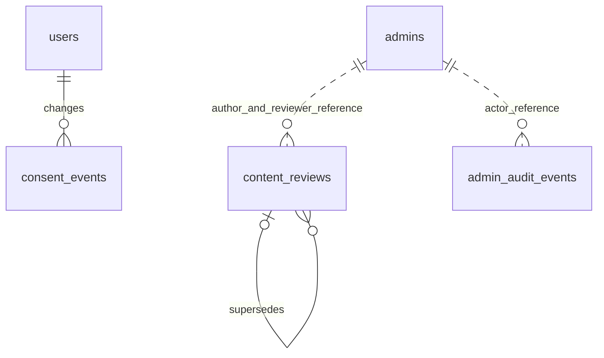

# 의료기관·동의·탈퇴·관리자 검수 API

2026-11-01. 기존 사진 분석 응답/모델 로딩 형식은 유지한다. 사용자 기능은 모바일 앱, 관리자 기능은 `/admin/` 웹과 ADMIN API로 분리한다.

## 의료기관

기존 `GET /api/wc/hospitals`와 관리자 기관 CRUD는 그대로 유지한다. 추가된 `GET /api/wc/hospitals/public`은 USER 권한을 요구한다.

| 입력 | 의미 |
|---|---|
| kind | `HOSPITAL` 또는 `PHARMACY`, 필수 |
| sido / sigungu / name | 시도 / 시군구 / 기관명. 각각 30/60/100자 이하 |
| page / size | 0부터 시작 / 1~50, 기본 20 |

응답은 `{status,items,page,size,hasNext,total,sourceUrl,fetchedAt}`. 기관 항목은 `{id,name,address,tel,category,latitude,longitude,emergency}`이다. `status=OK`이며 `total=0`인 경우만 정상적인 검색 결과 없음이다. `UNCONFIGURED`, `AUTH_ERROR`, `RATE_LIMITED`, `UNAVAILABLE`, `INVALID_RESPONSE`는 `total=null`로 반환하고 앱에서 별도 안내한다. `emergency=null`은 미확인이다. 조회 시각은 기관의 검수일이나 실시간 진료 여부가 아니다.

국립중앙의료원 [병·의원](https://www.data.go.kr/data/15000736/openapi.do), [약국](https://www.data.go.kr/data/15000576/openapi.do) API의 `Q0/Q1/QN`, `pageNo/numOfRows`를 사용한다. 서비스키는 서버의 **디코딩된 원본 키**를 설정하고 URI에서 한 번 인코딩한다. 리다이렉트를 따르지 않으며 연결 3초/읽기 5초 제한, 2MiB 응답 제한, 동시 요청 4개 제한, 외부 XML 엔티티 차단을 적용한다. 공급자 응답 본문·키·요청 URL은 오류 로그에 기록하지 않는다.

앱의 위치 요청은 버튼을 누를 때만 수행한다. 좌표는 앱 메모리에서 직선거리 계산에 사용하며 SkinCare 서버로 전송하거나 저장하지 않는다. 거리는 **불러온 결과 안에서만** 정렬한다. 전체 주변 기관의 거리순 검색, 길찾기 거리, 영업 중/응급실 수용 가능 조회를 제공한다고 표시하지 않는다. 위치 거부 시 지역·이름 검색과 외부 지도를 이용할 수 있다.

## 목적별 동의

`PUT /api/wc/users/me/consents`의 기존 terms/privacy 필드를 유지하고 다음 필수 필드를 추가했다.

```json
{"agreedTerms":true,"agreedPrivacy":true,"termsVersion":"2026-10-29","privacyVersion":"2026-10-29","agreedHealthData":true,"healthDataVersion":"2026-11-01"}
```

건강정보 처리 동의는 별도 체크박스다. 과거 계정에 소급 동의시키지 않으며, 기존 동의만 있는 계정은 ONBOARDING 권한으로 재동의한다. 최신 앱 배포가 필요하다. 동의 전에도 로그아웃·동의 내역 조회·탈퇴가 가능하다. 실제 약관·개인정보 처리방침 URL이 없으면 앱에서 동의 제출을 막는다. 후속 보완에서 앱은 서버의 정책 문서·버전을 조회하며, 서버도 필수 문서가 없으면 동의 요청을 거부한다. [최신 명세](service-readiness.md)를 따른다.

`GET /api/wc/users/me/consents?page=0&size=20`: 건강정보 동의, 학습 동의 상태, 안내 URL, 본인 변경 이력을 반환한다. 기존 약관 동의 이력은 소급 생성하지 않는다.

`PUT /api/wc/users/me/consents/training`: `{granted:boolean,version:"2026-11-01"}`. 선택 동의이며 기본 false다. `TRAINING_POLICY_URL`이 없으면 신규 true 요청은 409, false 거절·철회는 가능하다. 필수 동의 저장은 학습 동의를 변경하지 않는다. 같은 상태의 반복 요청은 이력을 중복 생성하지 않는다. 거절·철회로 분석 서비스를 차단하지 않는다. **학습 반출 기능은 항상 비활성화**되어 있고 이 API가 사용자 사진을 기존 학습 데이터에 편입하지 않는다.

## 탈퇴

`DELETE /api/wc/users/me`: `{confirmation:"탈퇴"}`. 기존 경로와 성공 응답 형태를 유지하되, 사용자 확인 문구가 없으면 400이다. 모바일은 삭제 범위를 안내하고 문구 입력 후 제출한다.

사용자 행을 잠그고 한 DB 트랜잭션에서 문의 답변/문의, 이전 진단·회복·지표, 분석 답변·사진 BLOB·문진·결과·메모, 동의 이력, 알림 설정, 리프레시 토큰, 계정을 삭제한다. 다른 계정과 공유하지 않는 이메일의 과거 인증/재설정 토큰도 제거한다. 실패 시 전체 롤백한다. 탈퇴와 계정 쓰기를 직렬화하여 늦은 요청이 기록을 되살리지 않게 한다. JWT는 사용자 조회가 실패하므로 즉시 무효화된다. 같은 소셜 계정으로 재가입하면 새 계정이다. 제공자 계정 자체나 제공자 측 연결은 이 API가 삭제하지 않는다.

`account_erasure_receipts`에는 복원 차단용 무작위 계정 ID와 접수 시각만 남긴다. 로그인 제공자 subject/이메일/사진/증상은 남기지 않는다. 과거의 소프트 탈퇴 계정을 일괄 삭제하지 않았다. 기존 레거시 테이블의 외부 이미지 URL은 참조만 삭제하며 소유권 없는 외부 저장소에 삭제 요청을 보내지 않는다. 현재 앱 사진은 DB BLOB이다.

백업 파일은 즉시 파기하지 않는다. 개발 복원 도구는 현재 원본 DB의 삭제 목록과 별도 `private/erasure-ledger.json`을 읽어 새 복원 DB에서 해당 계정·자료를 제거한 뒤 앱 권한을 부여한다. 현재 원본 DB가 없으면 자동 복원을 중단한다. 전체 재해 복구에는 최신 삭제 목록의 별도 보존과 수동 검증이 필요하다. 복원 시점 이후의 탈퇴는 자동 전파되지 않으므로, 실제 전환 전 원본 앱의 쓰기를 중지하고 최신 삭제 목록을 다시 반영해야 한다. 이 도구는 자동 운영 전환을 하지 않는다. **서비스·백업·감사·삭제 목록의 운영 보관기간과 법정 예외는 아직 확정하지 않았다.** 운영 전 정책 검토가 필요하며 법적 준수 완료로 표시하지 않는다.

## 관리자 감사·검수

`GET /api/wc/admin/audit?page=0&size=20`: 초기·추가 관리자 생성, 성공한 로그인/로그아웃/비밀번호 변경, 기관 등록·변경, 문의 상세 열람·답변, 검수 초안·요청·승인·반려 이력. actor/action/target/time 및 상태·버전·해시만 저장한다. API에 수정·삭제 기능은 없다. 실패한 인증 전체나 모든 읽기 요청을 수집하는 SIEM 기능은 아니며, DB 관리자의 직접 변조까지 막는 WORM 저장소는 아니다.

| API | 기능 |
|---|---|
| GET `/api/wc/admin/reviews` | 상태별 페이지 목록, 본문 제외 |
| GET `/api/wc/admin/reviews/{id}` | 고정 원문, SHA-256, 출처, 작성자, 검수 근거 |
| GET `/api/wc/admin/reviews/catalog/{kind}` | 현재 서버 빌드의 cards/bank/rules YAML 원문 |
| GET `/api/wc/admin/reviews/capabilities` | 현재 계정 임상 승인 권한, publishEnabled=false |
| POST `/api/wc/admin/reviews` | clientRequestId, kind, title, content, sourceUrl, supersedesId로 새 고정 버전 생성 |
| PUT `/api/wc/admin/reviews/{id}/state` | expectedVersion, action, reason, evidenceUrl |

종류는 `CARE_GUIDE/QUESTION_BANK/RISK_RULE/POLICY`, 상태는 `DRAFT → SUBMITTED → APPROVED 또는 REJECTED`. 작성자만 요청할 수 있고 작성자의 자기 승인·반려는 차단한다. 승인/반려는 근거 필수, 승인은 HTTPS 근거 URL도 필요하다. 상태 변경은 잠금·버전 검사로 중복/동시 덮어쓰기를 막는다. 원문 수정은 이전 ID를 가리키는 새 자료로 생성한다.

임상 자료 승인은 운영자가 `SKINCARE_CLINICAL_REVIEWERS`에 지정한 별도 ADMIN ID만 가능하다. 현재 지정자는 없다. 설정은 자격증 진위 확인을 자동 수행하지 않으므로 실제 검수 담당자 확인이 선행되어야 한다. POLICY 승인 기록도 법률 검토나 서비스 배포 완료를 뜻하지 않는다. 승인 자료를 AI 규칙·문진·케어에 자동 반영하는 API는 없다. 임상 콘텐츠는 연구·시연 상태를 유지한다.

## DB 구조 및 호환성

V004는 users에 건강정보/학습 동의 필드를 추가하고 `consent_events`, `account_erasure_receipts`, `admin_audit_events`, `content_reviews`를 생성한다. 기존 행을 삭제하거나 동의를 true로 채우지 않는다. V001~V003 파일 체크섬은 변경하지 않는다. `mysql` 프로필의 validate를 유지한다.



삭제 확인용 account_erasure_receipts에는 탈퇴한 사용자 FK를 두지 않는다. 관리자 참조는 문자열 이력으로 유지한다. 기존 사진 저장·문진 이어하기·결과 조회·경과 API 구조와 AI 기본 모델은 유지했다.
