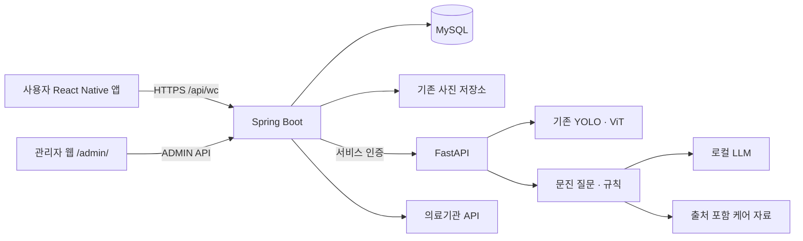

# 프로젝트 구조 (2026-11-04)

기존 서비스를 유지하면서 사용자 앱, 관리자 웹, 백엔드, AI의 소스 책임을 나눈 구조다. 폴더 정리는 모델 재학습이나 서비스 동작 변경을 뜻하지 않는다.

```text
SkinCare-AI/
├─ mobile/                       # Expo · React Native · TypeScript 사용자 앱
│  ├─ App.tsx                    # 폰트/안전 영역 초기화 → AppNavigator
│  ├─ src/
│  │  ├─ components/             # 버튼, 카드, 사진, 경과 비교 등 공통/부분 UI
│  │  ├─ screens/                # Login, Consent, Home, Capture, Analysis,
│  │  │                          # History, Encyclopedia, Hospitals, Account, Inquiries
│  │  ├─ navigation/             # AppNavigator, BottomNavigation
│  │  ├─ services/               # 기존 분석·계정·OAuth·사진 API/기기 연동
│  │  ├─ hooks/                  # useReducedMotion
│  │  ├─ stores/                 # authStore, fontContext
│  │  ├─ utils/                  # 날짜 표시, 기록 정렬
│  │  ├─ constants/              # 메뉴, 백과 자료, 폰트 라이선스
│  │  └─ types/                  # analysis, navigation, library
│  ├─ assets/fonts/              # 기존 폰트와 라이선스
│  ├─ android/                   # 기존 네이티브 빌드 설정
│  └─ package.json
├─ admin-web/                    # 관리자 전용 웹, 기존 HTML/CSS/JS 유지
│  ├─ index.html                 # 관리자 화면 마크업
│  ├─ app.js                     # 호환 진입점 → src/main.js
│  ├─ style.css                  # 호환 진입점 → src/layouts/admin.css
│  ├─ src/
│  │  ├─ main.js                 # 페이지별 이벤트 등록
│  │  ├─ components/             # 메시지/잠금 상태, 페이지 이동
│  │  ├─ pages/                  # 인증, 대시보드, 문의, 기관, AI 상태,
│  │  │                          # 검수, 감사, 관리자 계정
│  │  ├─ layouts/                # 메뉴 전환과 전체 스타일
│  │  ├─ services/               # 동일 출처 관리자 API 클라이언트
│  │  ├─ hooks/                  # 공통 비동기 작업 처리 (일반 JS 함수)
│  │  ├─ stores/                 # 메모리 내 관리자 상태
│  │  ├─ utils/                  # DOM 생성/조회
│  │  ├─ constants/              # 상태/유형 표시 문구
│  │  └─ types/                  # API 응답 참고 타입 (.d.ts)
│  ├─ scripts/check.mjs          # JS 구문·상대 import 검사
│  └─ package.json
├─ backend/                      # Spring Boot · Java 17
│  ├─ src/main/java/skincare/
│  │  ├─ domain/                 # 기존 도메인 및 엔티티 계층 유지
│  │  ├─ controller/
│  │  ├─ service/
│  │  ├─ repository/
│  │  ├─ dto/
│  │  ├─ config/
│  │  ├─ security/
│  │  ├─ exception/
│  │  └─ external/
│  ├─ src/main/resources/
│  │  ├─ application.yml
│  │  ├─ application-mysql.yml
│  │  └─ application-local.yml   # mysql 검증 설정을 가져오는 선택 프로필
│  ├─ src/test/
│  └─ build.gradle               # admin-web의 JS/CSS 하위 폴더도 JAR에 포함
├─ ai/                           # FastAPI, 기존 학습/추론 경로 유지
│  ├─ app/                       # main, config, deps, middleware
│  │  ├─ routers/                # predict, question, analyze, guide, tracking,
│  │  │                          # feedback, retrain, health
│  │  └─ schemas/                # vision, qa, common
│  ├─ vision/                    # quality, detect, classify, gate,
│  │                            # preprocess, explain, pipeline
│  ├─ qa/                        # 질문/규칙 YAML, bank_loader, orchestrator,
│  │                            # rules_engine, filter, llm_client, slots
│  ├─ guide/                     # cards, avoid_labels, denylist, retrieve, build_index
│  ├─ tracking/                  # compare
│  ├─ jobs/                      # retrain_worker, queue_store, feedback_store
│  ├─ models/                    # 모델 관련 자원/안내 (ONNX 전용이 아님)
│  ├─ scripts/                   # export_onnx, smoke_onnx, smoke_api, deploy_model
│  ├─ tests/
│  ├─ train_*.py, eval_*.py, …    # 기존 학습/평가 CLI 호환 경로
│  ├─ Dockerfile, docker-compose.yml
│  └─ requirements.txt, config.yaml, .env.example
├─ docs/
│  ├─ api/                       # 실제 API/상태 계약
│  ├─ db/                        # 기존 버전별 마이그레이션
│  ├─ diagrams/                  # 이 문서와 서비스 구성
│  └─ test/                      # 검증 방법과 한계
├─ deploy/                       # 기존 로컬/공개 시연 빌드·실행 도구
├─ data/                         # 기존 데이터/검수 관련 자료, 보존
└─ README.md
```

## 서비스 경계



관리자 웹은 Spring Boot가 `/admin/`에서 제공한다. 관리자 로그인 페이지가 공개되어 있어도 관리자 API에는 기존 ADMIN 인증이 필요하다. 모바일은 사용자 소셜 로그인만 제공하며 관리자 기능을 포함하지 않는다.

## 기존 경로와 변경 경로

| 이전 | 변경 후 |
| --- | --- |
| mobile/App.tsx의 앱 상태/탐색 | mobile/src/navigation/AppNavigator.tsx |
| App.tsx의 사진 선택·기록·분석 화면 | screens/CaptureScreen.tsx, HistoryScreen.tsx, AnalysisScreen.tsx |
| components/AuthScreen.tsx | screens/LoginScreen.tsx |
| components/PolicyOnboarding.tsx | screens/ConsentScreen.tsx |
| components/HomePanel.tsx | screens/HomeScreen.tsx |
| components/AccountPanel.tsx | screens/AccountScreen.tsx |
| components/HospitalPanel.tsx | screens/HospitalsScreen.tsx |
| components/InquiryPanel.tsx | screens/InquiriesScreen.tsx |
| components/EncyclopediaPanel.tsx | screens/EncyclopediaScreen.tsx |
| components/BottomNavigation.tsx | navigation/BottomNavigation.tsx |
| services/auth.ts | stores/authStore.ts |
| src/fontLicense.ts | constants/fontLicense.ts |
| admin-web/app.js의 기능 | admin-web/src의 페이지·API·상태 모듈 |
| admin-web/style.css의 스타일 | admin-web/src/layouts/admin.css |

새 화면은 `screens`, 재사용 부분 UI는 `components`, HTTP 연동은 `services`에 둔다. 모바일 `navigation`은 화면 선택과 현재 분석 세션의 전환을 조율한다. 상태 관리 라이브러리나 React Navigation을 새로 도입하지 않았다.

관리자 웹은 브라우저 ES Modules를 사용한다. `types/api.d.ts`는 참고용 타입이며 JavaScript 전체의 TypeScript 검증을 의미하지 않는다. `hooks/taskRunner.js`는 React Hook이 아니라 기존 비동기 UI 작업 래퍼다.

## 설정 및 보존 범위

- API URL, 요청/응답 형식, 소셜 콜백, 관리자 `/admin/`, 기존 기본 모델은 유지한다.
- 실제 키는 기존 비공개 환경 설정에 둔다. `application-local.yml`에는 키를 넣지 않는다. 이 선택 프로필은 `application-mysql.yml`을 가져오고 `ddl-auto=validate`를 유지한다. 데이터베이스 생성이나 마이그레이션을 실행하지 않는다.
- `ai/train_classify.py`, `eval_classify.py` 등은 추론 코드 import와 배포 스크립트가 참조하므로 기존 위치에 둔다. 새 빈 대체 파일이나 가짜 ONNX 모델을 만들지 않는다.
- 가중치, 데이터셋, 라벨, DB, 업로드 사진, 서명키는 이번 폴더 정리 대상이 아니다.
- 현재 실행 중인 서버 번들과 설치 APK에는 소스 정리가 자동 반영되지 않는다. 다음 정상 빌드/배포 시 새 경로를 포함한다.

검증 방법은 [테스트 안내](../test/README.md), 모델 보관 방식은 [AI 안내](../../ai/README.md)를 참고한다.
